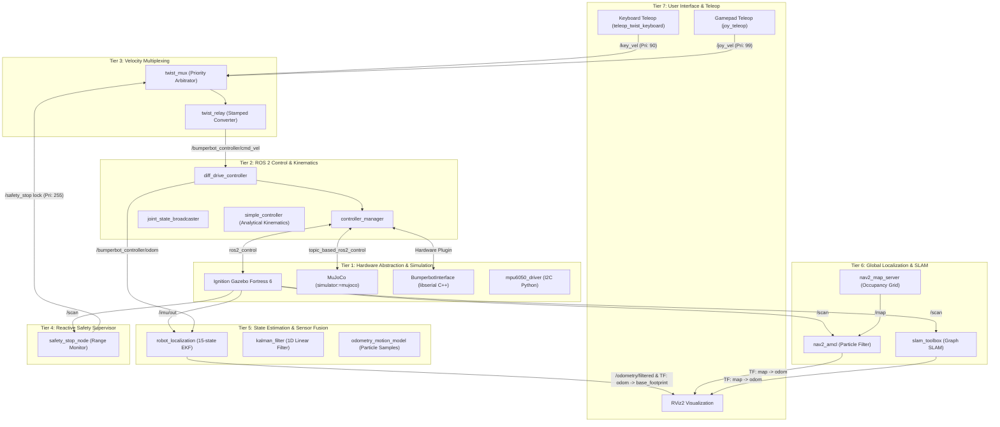

# BumperBot ROS 2 Humble Workspace

[](https://docs.ros.org/en/humble/)
[](https://releases.ubuntu.com/22.04/)
[](https://en.cppreference.com/)
[](https://www.python.org/)
[](https://gazebosim.org/)
[](LICENSE)

BumperBot is an end-to-end Autonomous Mobile Robot (AMR) system developed in **ROS 2 Humble** on **Ubuntu 22.04 LTS**. It bridges embedded hardware control, kinematics, multi-sensor perception, Kalman filtering, SLAM, and global localization into a unified, modular architecture.

---

## Table of Contents

- [1. Project Overview](#1-project-overview)
- [2. System Architecture](#2-system-architecture)
- [3. Repository Structure](#3-repository-structure)
- [4. Package Reference](#4-package-reference)
- [5. Prerequisites](#5-prerequisites)
- [6. Installation and Build](#6-installation-and-build)
- [7. Quick Start](#7-quick-start)
- [8. Feature Verification Guides](#8-feature-verification-guides)
- [9. ROS 2 Command Reference](#9-ros-2-command-reference)
- [10. Troubleshooting](#10-troubleshooting)
- [11. Technical Documentation Index](#11-technical-documentation-index)
- [12. AI Development Workflow](#12-ai-development-workflow)

---

## 1. Project Overview

BumperBot is designed for roboticists and embedded software engineers mastering differential-drive mobile robotics, sensor fusion, state estimation, and physical deployment.

### Key Capabilities

- **Kinematics & Control**: Differential-drive kinematics implemented in both C++ (`rclcpp`) and Python (`rclpy`), alongside standard `ros2_control` (`diff_drive_controller`).
- **Physics Simulation**: Ignition Gazebo Fortress 6 integration with realistic physics, friction, LiDAR, and IMU sensor plugins using `ros_gz_bridge`, or MuJoCo (`simulator:=mujoco`) with the same worlds and sensor topics.
- **Velocity Multiplexing & Safety**: Priority-based command arbitration via `twist_mux` and a 2-tier reactive LiDAR safety supervisor with dynamic slowdown and emergency braking.
- **State Estimation & Fusion**: 1D linear Kalman filter, Thrun's probabilistic sample odometry motion model, and 15-state Extended Kalman Filter (`robot_localization`).
- **Mapping & SLAM**: Known-pose ray-projection occupancy grid mapper and full Graph SLAM using `slam_toolbox`.
- **Global Localization**: Adaptive Monte Carlo Localization (`nav2_amcl`) with particle cloud convergence in pre-mapped environments.
- **Physical Robot Interface**: Custom `hardware_interface::SystemInterface` plugin communicating with an Arduino PID controller over serial (`libserial`), coupled with an MPU6050 I2C IMU driver.
- **Pedagogical Foundations**: 12 mirrored tutorial modules comparing C++ and Python ROS 2 implementations (Pub/Sub, Services, Actions, Parameters, QoS, Lifecycle nodes, and TF2).

### Current Implementation Status

| Subsystem | Status | Implementation Details |
| :--- | :---: | :--- |
| **URDF / Xacro Modeling** | Verified | Visual/collision meshes, inertia tensors, sensor frames |
| **Gazebo Physics Simulation** | Verified | Ignition Fortress 6 world, `ros_gz_bridge`, sensor topics |
| **Differential Drive Control** | Verified | `diff_drive_controller`, custom C++/Python kinematics nodes |
| **Safety Supervisor & Mux** | Verified | 2-tier range check (`/safety_stop`), priority arbitration |
| **Sensor Fusion (EKF)** | Verified | `robot_localization` fusing noisy wheel odometry & IMU |
| **Known-Pose Mapping** | Verified | Custom occupancy grid generator (`mapping_with_known_poses`) |
| **2D Graph SLAM** | Verified | `slam_toolbox` asynchronous cartographic mapping |
| **AMCL Localization** | Verified | `nav2_amcl` particle filter with map server lifecycle |
| **Hardware Interface** | Verified | C++ `hardware_interface` over `/dev/ttyUSB0` + Arduino PID |
| **Autonomous Exploration** | Verified | `frontier_explorer`: frontier detection, grid A*, pure pursuit on top of `slam_toolbox`, saves the map when done (`auto_explore.launch.py`) |
| **Autonomous Navigation (Nav2)** | Planned | Architectural blueprint provided in [doc/10_navigation.md](doc/10_navigation.md) |

---

## 2. System Architecture

The robot software stack is organized into 7 decoupled layers:



For complete architectural details, concurrency models, and sequence diagrams, see [doc/02_system_architecture.md](doc/02_system_architecture.md).

---

## 3. Repository Structure

```text
bumperbot_ws/
├── doc/                                # Comprehensive technical manuals
│   ├── 00_project_overview.md          # Architecture overview & feature matrix
│   ├── 01_repository_structure.md      # Detailed directory tree & dependency graph
│   ├── 02_system_architecture.md       # 7-tier architecture & data pipelines
│   ├── 03_ros2_nodes_topics_services.md# Full catalog of nodes, topics & services
│   ├── 04_tf_and_coordinate_frames.md  # REP-105 coordinate frames & TF2 trees
│   ├── 05_robot_description_and_simulation.md # URDF, Xacro & Gazebo configuration
│   ├── 06_odometry_and_motion_control.md      # Kinematics equations & twist_mux
│   ├── 07_lidar_and_sensor_processing.md      # LiDAR supervisor, IMU & safety stop
│   ├── 08_mapping_and_slam.md          # Known-pose mapping & slam_toolbox
│   ├── 09_localization.md              # 1D Kalman filter, EKF & AMCL
│   ├── 10_navigation.md                # Nav2 gap analysis & implementation plan
│   ├── 11_build_run_and_command_reference.md  # Verified build, launch & test commands
│   └── 12_troubleshooting.md           # Master diagnostic matrix & known fixes
├── src/
│   ├── bumperbot_bringup/              # Master launch files for sim & physical robot
│   ├── bumperbot_controller/           # Kinematics, odometry, teleop & twist_mux
│   ├── bumperbot_description/          # URDF/Xacro models, meshes, Gazebo worlds
│   ├── bumperbot_firmware/             # Hardware interface, serial drivers, Arduino
│   ├── bumperbot_localization/         # Kalman filter, EKF configs & AMCL launch
│   ├── bumperbot_mapping/              # Known-pose occupancy mapper & SLAM Toolbox
│   ├── bumperbot_msgs/                 # Custom ROS 2 IDL messages, services, actions
│   ├── bumperbot_mujoco/               # MuJoCo robot/world models, ROS 2 bridge node, converters
│   ├── bumperbot_utils/                # Reactive LiDAR safety supervisor
│   ├── bumperbot_cpp_examples/         # C++ (rclcpp) tutorials & API patterns
│   └── bumperbot_py_examples/          # Python (rclpy) tutorials & API patterns
├── CLAUDE.md                           # Project guidance for Claude Code
└── README.md                           # Master repository guide (this file)
```

---

## 4. Package Reference

| Package | Type | Primary Responsibilities | Key Nodes & Entry Points | Documentation |
| :--- | :--- | :--- | :--- | :--- |
| **`bumperbot_bringup`** | `ament_cmake` | Master system integration & unified launch orchestration | `simulated_robot.launch.py`, `real_robot.launch.py`, `auto_explore.launch.py` | [doc/01_repository_structure.md](doc/01_repository_structure.md) |
| **`bumperbot_controller`** | `ament_cmake` + Python | Analytical kinematics, noisy odometry, and teleop arbitration | `simple_controller`, `noisy_controller`, `twist_relay` | [doc/06_odometry_and_motion_control.md](doc/06_odometry_and_motion_control.md) |
| **`bumperbot_description`** | `ament_cmake` | URDF/Xacro modeling, visual/collision meshes, Gazebo worlds | `display.launch.py`, `gazebo.launch.py` | [doc/05_robot_description_and_simulation.md](doc/05_robot_description_and_simulation.md) |
| **`bumperbot_mujoco`** | `ament_python` | MuJoCo simulation: robot and world MJCF models, ROS 2 bridge (`/clock`, `/scan`, `/imu/out`, wheel commands) | `mujoco_sim_node`, `mujoco.launch.py` | [doc/05_robot_description_and_simulation.md](doc/05_robot_description_and_simulation.md) |
| **`bumperbot_firmware`** | `ament_cmake` + Python | Hardware interface plugin, serial transceiver, Arduino PID | `bumperbot_interface` (plugin), `mpu6050_driver` | [doc/06_odometry_and_motion_control.md](doc/06_odometry_and_motion_control.md) |
| **`bumperbot_localization`** | `ament_cmake` + Python | 1D Kalman filter, particle sampling, EKF & AMCL configs | `kalman_filter`, `odometry_motion_model`, `imu_republisher` | [doc/09_localization.md](doc/09_localization.md) |
| **`bumperbot_mapping`** | `ament_cmake` + Python | Known-pose occupancy grid generation & Graph SLAM | `mapping_with_known_poses`, `frontier_explorer`, `slam.launch.py` | [doc/08_mapping_and_slam.md](doc/08_mapping_and_slam.md) |
| **`bumperbot_utils`** | `ament_cmake` + Python | 2-tier reactive LiDAR safety supervisor with RViz markers | `safety_stop` (.cpp/.py) | [doc/07_lidar_and_sensor_processing.md](doc/07_lidar_and_sensor_processing.md) |
| **`bumperbot_msgs`** | `ament_cmake` | Custom IDL definitions (`AddTwoInts`, `GetTransform`, `Fibonacci`) | Interfaces generation | [doc/03_ros2_nodes_topics_services.md](doc/03_ros2_nodes_topics_services.md) |
| **`bumperbot_cpp_examples`** | `ament_cmake` | C++ (`rclcpp`) reference implementations | 12 tutorial nodes (Pub/Sub, Service, Action, TF2, QoS) | [doc/03_ros2_nodes_topics_services.md](doc/03_ros2_nodes_topics_services.md) |
| **`bumperbot_py_examples`** | `ament_python` | Python (`rclpy`) reference implementations | 12 tutorial nodes (Pub/Sub, Service, Action, TF2, QoS) | [doc/03_ros2_nodes_topics_services.md](doc/03_ros2_nodes_topics_services.md) |

---

## 5. Prerequisites

- **Operating System**: Ubuntu 22.04 LTS (Jammy Jellyfish) 64-bit x86_64 or ARM64
- **ROS 2 Distribution**: ROS 2 Humble Hawksbill
- **Simulator**: Ignition Gazebo Fortress 6 (`ign gazebo` / `ros-humble-ros-gz`)
- **Compilers & Interpreters**: GCC/G++ 11.4+, Python 3.10+, CMake 3.22+
- **Serial & I2C Libraries**: `libserial-dev`, `python3-smbus`

---

## 6. Installation and Build

### Step 1: Install System & ROS 2 Dependencies

```bash
sudo apt update
sudo apt install -y \
  ros-humble-ros-gz \
  ros-humble-ros-gz-sim \
  ros-humble-ros-gz-bridge \
  ros-humble-ros2-control \
  ros-humble-ros2-controllers \
  ros-humble-diff-drive-controller \
  ros-humble-joint-state-broadcaster \
  ros-humble-joy \
  ros-humble-joy-teleop \
  ros-humble-twist-mux \
  ros-humble-slam-toolbox \
  ros-humble-nav2-amcl \
  ros-humble-nav2-map-server \
  ros-humble-nav2-lifecycle-manager \
  ros-humble-robot-localization \
  ros-humble-tf-transformations \
  ros-humble-teleop-twist-keyboard \
  libserial-dev \
  python3-smbus
```

### Step 2: Build the Workspace

```bash
cd ~/bumperbot_ws
source /opt/ros/humble/setup.bash

# Build all packages with symbolic install links
colcon build --symlink-install
```

### Step 3: Source the Overlay

```bash
source install/setup.bash
```

> [!TIP]
> Add `source ~/bumperbot_ws/install/setup.bash` to your `~/.bashrc` for automatic environment setup in new terminal windows.

---

## 7. Quick Start

### Simulation with Pre-Mapped Localization (AMCL)

Launch the simulated robot in a fully furnished house with AMCL localization, the reactive safety stop supervisor, and RViz2:

```bash
# Terminal 1: Full Simulation Bringup
source install/setup.bash
ros2 launch bumperbot_bringup simulated_robot.launch.py world_name:=small_house use_slam:=False
```

```bash
# Terminal 2: Keyboard Teleoperation
source install/setup.bash
ros2 run teleop_twist_keyboard teleop_twist_keyboard --ros-args -r cmd_vel:=/key_vel
```

**What to expect:**
1. **Ignition Gazebo**: Displays BumperBot inside the `small_house` world.
2. **RViz2**: Visualizes the robot 3D model, laser scan (`/scan`), occupancy grid map, and the green AMCL particle cloud converging around the robot.
3. **Teleop & Safety**: Control the robot using keys `i`, `j`, `k`, `l`, `,`. If you drive towards a wall, the robot automatically slows down within 0.40m (warning zone) and comes to an emergency halt within 0.20m (danger zone).

### Simulation on MuJoCo (Alternative to Gazebo)

The same stack runs on MuJoCo by passing `simulator:=mujoco`. Gazebo stays the default.

```bash
# Terminal 1: Full bringup on MuJoCo (AMCL localization; add use_slam:=True for SLAM instead)
source install/setup.bash
ros2 launch bumperbot_bringup simulated_robot.launch.py simulator:=mujoco world_name:=small_house
```

```bash
# Terminal 2: Keyboard teleoperation (same command as with Gazebo)
source install/setup.bash
ros2 run teleop_twist_keyboard teleop_twist_keyboard --ros-args -r cmd_vel:=/key_vel
```

**Keyboard control:**
- `twist_mux` listens to `/key_vel` (priority 90). The gamepad on `joy_vel` (priority 99) overrides the keyboard while it is in use.
- Keys: `i` forward, `,` backward, `j`/`l` rotate left/right, `k` stop, `q`/`z` increase/decrease speed.
- Keep the terminal focused and hold the key: commands time out after 0.5 s and the robot stops.
- Without a TTY, publish to the same topic instead: `ros2 topic pub -r 10 /key_vel geometry_msgs/msg/Twist "{linear: {x: 0.3}}"`.

**Verified on MuJoCo (headless-safe topics):** `/clock` and `/imu/out` at 100 Hz, `/scan` at 5 Hz, odometry at 50 Hz, AMCL publishes `map -> odom`, and `slam_toolbox` builds `/map` while driving. SLAM and map saving use the same commands as in Section 8.3.

---

## 8. Feature Verification Guides

### 1. Robot Model & Kinematic Sliders

Visualize the robot model in RViz2 and articulate joints manually:

```bash
ros2 launch bumperbot_description display.launch.py
```

### 2. Standalone Physics Simulation

Launch Ignition Gazebo Fortress with simulated sensors without the full bringup stack:

```bash
ros2 launch bumperbot_description gazebo.launch.py world_name:=small_house
```

The same worlds run in MuJoCo (requires `pip install mujoco` and `ros-humble-topic-based-ros2-control`):

```bash
ros2 launch bumperbot_mujoco mujoco.launch.py world_name:=small_house
# or the full stack on top of MuJoCo
ros2 launch bumperbot_bringup simulated_robot.launch.py simulator:=mujoco world_name:=small_house
```

### 3. Real-Time SLAM (Mapping an Unknown Environment)

Map a world dynamically using `slam_toolbox`:

```bash
# Terminal 1: Launch simulation in SLAM mode
ros2 launch bumperbot_bringup simulated_robot.launch.py world_name:=small_house use_slam:=True

# Terminal 2: Teleoperate to map the room
ros2 run teleop_twist_keyboard teleop_twist_keyboard --ros-args -r cmd_vel:=/key_vel

# Terminal 3: Save the completed map
ros2 run nav2_map_server map_saver_cli -f ~/my_new_map --ros-args -p use_sim_time:=True
```

### 3b. Autonomous Exploration (SLAM + frontier_explorer)

The robot maps an unknown closed environment on its own (no Nav2 needed):

```bash
# Gazebo (default) or MuJoCo; viewer:=false and use_rviz:=false run it headless
ros2 launch bumperbot_bringup auto_explore.launch.py simulator:=mujoco world_name:=small_house
# Optional: choose where the map is saved (default ~/bumperbot_maps/explored_map)
#   map_save_path:=/path/to/my_map

# Progress: EXPLORING -> COMPLETE -> MAP_SAVED (or MAP_SAVE_FAILED)
ros2 topic echo /explore/status
```

`frontier_explorer` publishes on `explore_vel`, a new `twist_mux` input with priority 10, so the joystick (99), the keyboard (90) and the `safety_stop` lock (255) always take over. When no reachable frontier is left it stops, saves `<map_save_path>.yaml/.pgm` through `nav2_map_server` (fallback: `slam_toolbox/save_map`) and reports `MAP_SAVED`. See [doc/08_mapping_and_slam.md](doc/08_mapping_and_slam.md). The node is Python-only (new node; its logic is a pure Python module shared with the headless tests).

SLAM map quality: `bumperbot_mapping/map_compare.py` compares a saved map with the reference after a rigid alignment and checks for fans and seams (see doc/08). The opt-in full-stack test runs with `BUMPERBOT_SLAM_E2E=1 colcon test --packages-select bumperbot_bringup --ctest-args -R test_slam_map_quality_mujoco` on its own `ROS_DOMAIN_ID`. When mapping, use a dedicated `ROS_DOMAIN_ID` and make sure no old simulator stack is running ([doc/12](doc/12_troubleshooting.md)). The MuJoCo model uses frictionless casters (`priority="1"`) and a stiffer wheel contact so that wheel odometry matches the true motion ([doc/05](doc/05_robot_description_and_simulation.md)).

### 4. Sensor Fusion with Extended Kalman Filter (EKF)

Fuse wheel odometry with simulated IMU orientation:

```bash
ros2 launch bumperbot_localization local_localization.launch.py
```

Inspect the filtered odometry output:

```bash
ros2 topic echo /odometry/filtered --field pose.pose.position
```

### 5. Probabilistic Motion Model (Particle Sampling)

Visualize Thrun's sample odometry motion model particle distributions in RViz2:

```bash
ros2 run bumperbot_localization odometry_motion_model
```

---

## 9. ROS 2 Command Reference

A quick reference for inspecting the active BumperBot system:

```bash
# Node & Lifecycle Inspection
ros2 node list
ros2 node info /simple_controller
ros2 lifecycle get /map_server

# Topic Verification
ros2 topic list
ros2 topic hz /scan
ros2 topic echo /bumperbot_controller/odom --field pose.pose.position
ros2 topic pub --once /key_vel geometry_msgs/msg/Twist "{linear: {x: 0.2}}"

# Service Invocations
ros2 service list
ros2 service call /add_two_ints bumperbot_msgs/srv/AddTwoInts "{a: 10, b: 25}"

# Action Invocations
ros2 action list
ros2 action send_goal /fibonacci bumperbot_msgs/action/Fibonacci "{order: 10}"

# Coordinate Frames & TF2
ros2 run tf2_tools view_frames
ros2 run tf2_ros tf2_echo odom base_footprint
ros2 run tf2_ros tf2_echo map odom
```

For the comprehensive command handbook, see [doc/11_build_run_and_command_reference.md](doc/11_build_run_and_command_reference.md).

---

## 10. Troubleshooting

| Symptom | Root Cause | Solution |
| :--- | :--- | :--- |
| **`Could not contact service /controller_manager/list_controllers`** | Orphaned Gazebo process holding lock on transport socket | Run `killall -9 ign ruby gz 2>/dev/null` before relaunching. |
| **`PackageNotFoundError: package 'twist_mux' not found`** | Missing binary ROS 2 dependency | Run `sudo apt install ros-humble-twist-mux`. |
| **Distorted/curved walls when turning robot fast during mapping** | Using `TimePointZero` instead of scan timestamp for TF lookup | Use `scan.header.stamp` for transform lookups in `mapping_with_known_poses.py`. |
| **`failed to create symbolic link ... Is a directory`** | Corrupted CMake/ament symlink artifact after build interrupt | Run `rm -rf build/<pkg> install/<pkg>` and rebuild. |
| **`Permission denied: /dev/ttyUSB0`** | User account lacks `dialout` group permissions | Run `sudo usermod -aG dialout $USER`, then log out and back in. |
| **Robot meshes invisible in Gazebo** | Ignition cannot locate resource directory | Export mesh path: `export IGN_GAZEBO_RESOURCE_PATH=$IGN_GAZEBO_RESOURCE_PATH:$(ros2 pkg prefix bumperbot_description)/share`. |

For the complete diagnostic decision tree, see [doc/12_troubleshooting.md](doc/12_troubleshooting.md).

---

## 11. Technical Documentation Index

Detailed architectural and theoretical guides are available in the [doc/](doc/) directory:

1. [**00. Project Overview & Feature Matrix**](doc/00_project_overview.md) — Scope, verification matrix, and architectural rationale.
2. [**01. Repository Structure & Dependencies**](doc/01_repository_structure.md) — Detailed file hierarchy and dependency breakdown.
3. [**02. System Architecture & Concurrency**](doc/02_system_architecture.md) — 7-tier pipeline, threading model, and sequence diagrams.
4. [**03. ROS 2 Nodes, Topics, Services & Actions**](doc/03_ros2_nodes_topics_services.md) — Exhaustive catalog of all ROS 2 communications.
5. [**04. Coordinate Frames, TF2 & REP-105**](doc/04_tf_and_coordinate_frames.md) — Transform trees, coordinate math, and REP-105 compliance.
6. [**05. Robot Description & Simulation**](doc/05_robot_description_and_simulation.md) — URDF/Xacro modeling, physics parameters, and Gazebo Fortress plugins.
7. [**06. Odometry & Motion Control**](doc/06_odometry_and_motion_control.md) — Differential kinematics, controller tuning, and `twist_mux`.
8. [**07. LiDAR Processing & Reactive Safety**](doc/07_lidar_and_sensor_processing.md) — Ray range filtering, IMU republisher, and safety supervisors.
9. [**08. Mapping & SLAM**](doc/08_mapping_and_slam.md) — Occupancy grid algorithms, raycasting, and `slam_toolbox`.
10. [**09. State Estimation & Localization**](doc/09_localization.md) — 1D Kalman filter, sample motion models, EKF, and AMCL.
11. [**10. Navigation & Path Planning (Nav2)**](doc/10_navigation.md) — Nav2 gap analysis and step-by-step production implementation blueprint.
12. [**11. Build, Run & Command Reference**](doc/11_build_run_and_command_reference.md) — Complete handbook of verified commands.
13. [**12. Troubleshooting & Diagnostics**](doc/12_troubleshooting.md) — Master failure diagnostic matrix and resolution procedures.
14. [**13. AI Development Workflow**](doc/13_ai_development_workflow.md) — Claude Code feature pipeline: subagents, skills, hooks and the implement/test loop.

---

## 12. AI Development Workflow

New features can be built with an automated Claude Code pipeline configured in `.claude/`:
the `architect` subagent (Opus) writes a plan with numbered acceptance criteria, then
`coder` and `tester` (Sonnet) loop until every criterion passes. Each stage is committed.
Hooks enforce the workspace rules (no edits in `build/`/`install/`/`log/`, no absolute
launch paths, no push or merge to `main`, lint after each edit).

```bash
/feature-pipeline <feature description> [--review] # full loop (autonomous by default)
/feature-plan | /feature-implement | /feature-test  # single stages
```

See [doc/13_ai_development_workflow.md](doc/13_ai_development_workflow.md).
